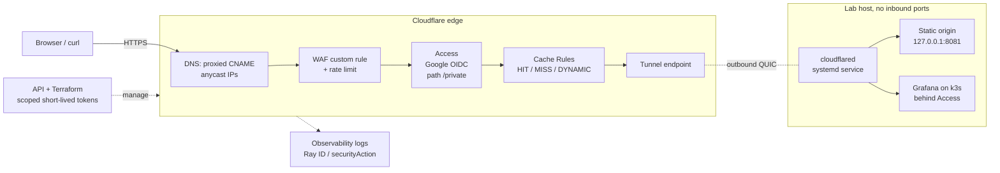

# Cloudflare-lab-edge-ops


[](LICENSE)

A one-person, hands-on lab that puts a small origin behind Cloudflare and exercises the edge the way an operator would: DNS and proxy, TLS mode, cache, WAF and rate limiting, Access with an identity provider, Tunnel failures and how to diagnose them, the API, Terraform and Observability logs.

> **Status: work in progress.** Everything under "Done" actually ran and was observed by the author. Everything under "To be completed" has **not** been done yet and is listed so the gaps are visible. Entries like `E-042` point to the evidence log [`docs/EVIDENCE.md`](docs/EVIDENCE.md): what ran, the output, and the limits of each claim. Screenshots follow in the next pull request; the log refers to some private originals that are not published.

## Architecture



The animation shows one request at a time. The four outcomes alternate (success, blocked by a WAF custom rule, `429` from the rate limit, `530` with error `1033`); they do not all happen at once. Each was observed in the lab, see the Done table. The Access denial for a second account is not drawn because it has not been run yet.

<details>
<summary>Static version (Mermaid source, also in <code>docs/diagrams/architecture.mmd</code>)</summary>



</details>

A browser or `curl` reaches proxied hostnames on Cloudflare's edge. Requests pass DNS, WAF and rate limiting, Access (on `/private` and on the Grafana host) and cache rules, then travel through a Cloudflare Tunnel. `cloudflared` runs on the lab host and opens outbound connections only, so the origin has no inbound ports. Logs and the API sit beside the data path.

## Done (ran and observed)

| Area | What ran | Evidence |
|---|---|---|
| DNS and proxy | Proxied CNAMEs to a tunnel; `dig` returns Cloudflare anycast IPs, not the origin | E-036, E-041, E-042 |
| TLS | SSL/TLS mode read in the dashboard and through the API (`full`); read only, not changed | E-049, E-112 |
| Cache | Default cache by file extension; HTML is `DYNAMIC`; a Cache Rule by hostname gives `MISS` then `HIT`; rule deleted and cache purged returns to `DYNAMIC` | E-046, E-047, E-116, E-117 |
| WAF custom rule | Block `/blocked` at the edge; the origin log shows the request never arrived | E-052 to E-058 |
| Rate limit | 5 requests per 10 s on one path: `404` x5 then `429` x5 | E-060 to E-064 |
| Access (positive test) | Google as identity provider, application on `/private`, policy allowing one email; the allowed account got in | E-065 to E-090, E-130 |
| Failures | Origin stopped: `502`. Tunnel stopped: `530` with Cloudflare error `1033` | E-091 to E-099 |
| Failures (DNS-level) | Temporary proxied records reproduced `1014` (CNAME to a hostname in another Cloudflare account), `1016` (origin name that does not resolve) and `1033` (tunnel id that does not exist); all removed and verified | E-125 to E-129 |
| Observability | Edge logs export; `cf-ray` from `curl` matches `rayName` in the logs (6 of 6) | E-108, E-118, E-119 |
| API | Scoped read-only token; create, read and delete a throwaway TXT record | E-111 to E-113 |
| Terraform | `init`, `plan`, `apply`, verify with `dig`, `destroy` on one throwaway TXT record | E-114, E-115 |
| Connector maintenance | `cloudflared` upgraded from a local `.deb` after a security advisory; version and tunnel health checked | E-009 to E-012 |
| Runbook | Diagnosis guide written only from the cases above | [`docs/RUNBOOK.md`](docs/RUNBOOK.md) |
| Evidence log | 132 entries with commands, outputs, corrections and limits; personal values replaced by placeholders | [`docs/EVIDENCE.md`](docs/EVIDENCE.md) |

## To be completed (not done yet)

| Topic | Status |
|---|---|
| Access, negative test | Prepared (policy allows one email; a second Google account is registered as a test user). Not run yet: no denial has been captured, so no claim is made |
| Errors `520`-`526` | **Not reproduced.** Read in the documentation only. The home connection is behind carrier NAT and has no global IPv6, so no public origin was available (E-122 to E-124). Option kept open: a temporary cloud VM |
| TLS modes Full vs Full (strict) | Read only; not exercised. A study guide is planned |
| SAML vs OIDC identity providers, enforced MFA | Not started |
| WAF managed rules / OWASP | Not started (only a custom rule was used) |
| Terraform at scale | Not started (one resource, local state, no modules, no CI) |
| Network fundamentals notes (BGP, CIDR, NAT) and Network Services | Not started |
| Onboarding plan, call summary template, escalation templates, 20-minute workshop outline | Not started |
| DNS deep-dive guide | Not started |
| Masked screenshots | Reviewed; next pull request |

## Tools in this repo

- `scripts/cf_logs_summary.py`: summarises an Observability logs export (edge view); `--rays`, `--timeline`, `--host`, `--redact`. See [`docs/HOWTO_cf_logs_summary.md`](docs/HOWTO_cf_logs_summary.md).
- `scripts/har_summary.py`: summarises a browser HAR (browser view of one page load).

Both use only the Python standard library and run locally.

## Lessons learned

- Access identity provider: an autofilled *Email claim* field caused "User email was not returned"; the field must stay empty (E-071 to E-080).
- Cache Rule: matching on *URI Full* would not have matched a hostname-only rule; use *Hostname* (E-117).
- A token form meant to be read-only had *DNS Edit* ticked in one capture; it was corrected and the final token was read-only (E-111).
- A prediction was wrong: a CNAME to an `example.com` name gave `1014`, not `1016`, because that name is hosted on Cloudflare. Changing one variable (target inside the same zone) produced `1016` (E-125, E-126).
- A CNAME to a tunnel id that does not exist also gives `530` + `1033`, so the code alone does not tell "tunnel down" from "tunnel does not exist"; check the tunnel list (E-127).

## Known limits

One client, small traffic windows, free plan, a single zone, local Terraform state, no modules and no CI. See "To be completed" for what is not covered.

## Repository layout

```
docs/            runbook, evidence log, how-to, diagrams (architecture.svg animated, architecture.mmd source)
evidence/        masked exports and command outputs referenced by the log
scripts/         the two local summary tools
terraform/       the throwaway-record exercise (main.tf only; no state)
LICENSE          MIT
```

Planned in a later pull request: `evidence/screenshots/` (masked screenshots).

## Credits and references

Cloudflare documentation, by topic:

- DNS and proxy: [Proxy status](https://developers.cloudflare.com/dns/proxy-status/), [Manage DNS records](https://developers.cloudflare.com/dns/manage-dns-records/)
- Tunnel: [Cloudflare Tunnel](https://developers.cloudflare.com/cloudflare-one/networks/connectors/cloudflare-tunnel/), [Tunnel fundamentals](https://developers.cloudflare.com/tunnel/concepts/)
- SSL/TLS: [Encryption modes](https://developers.cloudflare.com/ssl/origin-configuration/ssl-modes/), [Full (strict)](https://developers.cloudflare.com/ssl/origin-configuration/ssl-modes/full-strict/)
- Cache: [Cache responses (HIT, MISS, DYNAMIC)](https://developers.cloudflare.com/cache/concepts/cache-responses/), [Cache Rules settings](https://developers.cloudflare.com/cache/how-to/cache-rules/settings/)
- WAF: [Custom rules](https://developers.cloudflare.com/waf/custom-rules/), [Rate limiting rules](https://developers.cloudflare.com/waf/rate-limiting-rules/)
- Access: [Access policies](https://developers.cloudflare.com/cloudflare-one/access-controls/policies/), [Google as identity provider](https://developers.cloudflare.com/cloudflare-one/identity/idp-integration/google/), [Enforce MFA](https://developers.cloudflare.com/cloudflare-one/access-controls/policies/mfa-requirements/)
- Errors: [1xxx errors](https://developers.cloudflare.com/support/troubleshooting/http-status-codes/cloudflare-1xxx-errors/), [Error 1033](https://developers.cloudflare.com/support/troubleshooting/http-status-codes/cloudflare-1xxx-errors/error-1033/), [5xx errors](https://developers.cloudflare.com/support/troubleshooting/http-status-codes/cloudflare-5xx-errors/), [Error diagnostic headers](https://developers.cloudflare.com/support/troubleshooting/http-status-codes/cloudflare-error-headers/)
- Logs: [Cloudflare Ray ID](https://developers.cloudflare.com/fundamentals/reference/cloudflare-ray-id/), [Log Search](https://developers.cloudflare.com/observability/logs/log-explorer/log-search/)
- API: [Create an API token](https://developers.cloudflare.com/fundamentals/api/get-started/create-token/), [API overview](https://developers.cloudflare.com/api/overview/)
- Terraform: [Cloudflare Terraform provider](https://developers.cloudflare.com/api/terraform/), [provider on the Terraform Registry](https://registry.terraform.io/providers/cloudflare/cloudflare/latest/docs)

Other:

- Grafana: [Deploy Grafana on Kubernetes](https://grafana.com/docs/grafana/latest/setup-grafana/installation/kubernetes/)
- Badges: [Shields.io](https://shields.io/)
