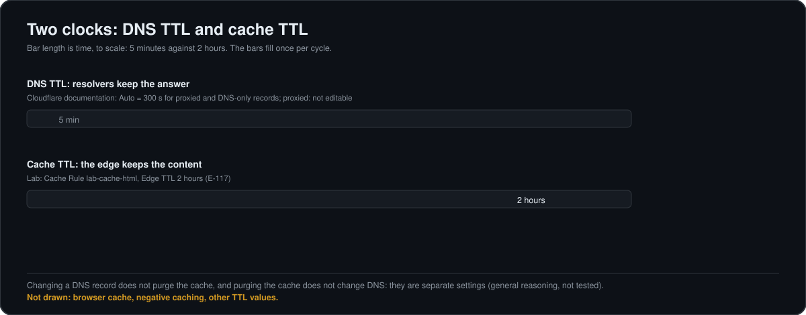

# DNS deep dive: records, CNAME, proxy, TTL and what the lab showed

A study guide written from the lab and from Cloudflare's documentation. Every statement carries one of three tags, so you can tell what was actually done:

- **[Lab]** ran and was observed in this lab. The entry `E-xxx` points to [`EVIDENCE.md`](EVIDENCE.md).
- **[Docs]** stated on a Cloudflare documentation page that was read (links at the end). Not reproduced here unless a Lab tag says so.
- **[General]** general DNS knowledge, not taken from a page read for this guide and not tested in the lab.

Hostnames use `<lab-domain>` for the lab's own domain. Last reviewed 2026-11-10.

## 1. What DNS does, in one page

**[General]** DNS turns a name into data. A *resolver* (usually your ISP's or a public one) asks the *authoritative name servers* of the zone and caches the answer for the record's TTL. A *zone* is the set of records a name server is responsible for. Each record has a name, a type, a value and a TTL.

**[Lab]** The zone of the lab domain is served by two Cloudflare name servers; its `SOA` and `NS` records appear in the zone export (E-038). `dig` asks a resolver the question and prints the answer (E-042):

```
dig +short lab.<lab-domain>
104.21.51.133
172.67.180.160
```

`+short` prints only the answer data. The two addresses are not the lab's origin: see section 4.



## 2. Record types

The Cloudflare "Add record" dialog listed, in the part visible in the screenshot, these types: A, AAAA, CAA, CERT, CNAME, DNSKEY, DS, HTTPS, LOC, MX, NAPTR, NS, OPENPGPKEY, PTR, SMIMEA; the list continued below the visible part (E-039, **[Lab]**). Purposes, as Cloudflare's record-type page describes them **[Docs]**:

| Type | Purpose | Used in the lab |
|---|---|---|
| `A` | Name to an IPv4 address | Not created |
| `AAAA` | Name to an IPv6 address | Not created |
| `CNAME` | Name to another hostname, which can then resolve other record types | Yes: every lab hostname (E-041) |
| `MX` | Where email for the domain is delivered | No |
| `TXT` | Text; most often domain ownership checks before certificate issuance | Yes: throwaway test records through the API and Terraform (E-113, E-115) |
| `CAA` | Which certificate authorities may issue certificates for the domain | No |
| `SRV` | Host and port of a service (VoIP, messaging) | No |
| `SVCB`, `HTTPS` | Connection details for a server before the first HTTP connection | No |
| `PTR` | IP address back to hostnames (reverse DNS) | No |
| `SOA` | Zone details: primary name server, admin contact, timing values | Seen in the zone export (E-038) |
| `NS` | The authoritative name servers; mostly used to delegate subdomains | Seen in the zone export (E-038) |
| `DS`, `DNSKEY` | DNSSEC: cryptographic signing of records | No |

Cloudflare also supports less common types such as URI, NAPTR, SSHFP, TLSA, SMIMEA and CERT **[Docs]**. Email authentication (SPF, DKIM, DMARC) is published as `TXT`-style records; the page groups them under email authentication **[Docs]**.

## 3. CNAME in depth

**[Docs]** A `CNAME` points a name to another hostname. The dashboard describes it as: "[name] is an alias of [target]" (the preview sentence of the form, E-039 and E-040, **[Lab]**).

**[General]** Two classic rules follow from that: a name that has a `CNAME` cannot also hold other record types, and a `CNAME` is not allowed at the zone apex (the bare domain, where `SOA` and `NS` must live). Cloudflare's *CNAME flattening* lets you use a `CNAME` at the apex: it finds the IP address the target resolves to, following extra `CNAME`s if needed, and returns that address instead of the `CNAME` **[Docs]**. The same page warns that flattening every `CNAME` can break third-party domain verification that needs the `CNAME` itself, and that a chain ending with no `A` or `AAAA` record answers empty (NODATA), which can look like a propagation problem **[Docs]**. The lab did not use flattening: it has no apex or `www` record (E-036).

## 4. Proxied or DNS-only, and what `dig` shows

**[Docs]** A proxied record sends HTTP and HTTPS traffic through Cloudflare. A DNS-only record answers with the origin's real address, so anyone who queries it learns the origin address. Only `A`, `AAAA` and `CNAME` records can be proxied; types such as `MX` and `TXT` are always DNS-only. Proxied records resolve to Cloudflare anycast addresses, not the origin.

**[Lab]** Every proxied hostname of the zone answered with the same two addresses, `104.21.51.133` and `172.67.180.160`, in rotating order: `lab`, `grafana` (E-042) and the temporary test records (E-125 to E-127). None of the answers showed the target of the `CNAME` or any address of the author's network. The new `lab` record answered in public DNS about a minute after it was created (E-042). The addresses are in the `104.21.x.x` and `172.67.x.x` ranges; they were not checked against Cloudflare's published list.

**[General]** Anycast means the same address is announced from many locations and a visitor reaches the nearest one. **[Lab]** The `cf-ray` header of every request ends in `-DFW`, the data center that received it (E-116, E-119).

How to read a `dig` answer for a proxied hostname (RUNBOOK section 8): Cloudflare addresses mean the proxy is in front, so a problem is above DNS. Only that case was observed; "no answer or `NXDOMAIN`" and "a different address (grey cloud)" are **[General]** readings and were not reproduced. A correct resolution says nothing about whether the page works (E-042).

## 5. The "Tunnel" record

**[Lab]** In the dashboard the hostnames of the lab show type `Tunnel`, content `lab-tunnel`, proxied, TTL Auto (E-036, E-041). The zone export shows what that is: a `CNAME` to `<tunnel-uuid>.cfargotunnel.com` with the tag `cf-proxied:true` (E-038). The UUID in the record equals the `tunnel:` value of the `cloudflared` configuration, compared by reading both (E-038, E-040).

**[Docs]** Every tunnel gets a `<UUID>.cfargotunnel.com` subdomain; to route a hostname to it you create a `CNAME` to that name (or run `cloudflared tunnel route dns`). The tunnel UUID is not secret, and `cfargotunnel.com` only proxies traffic for DNS records in the same Cloudflare account. The record and the tunnel are independent: the record can exist while the tunnel is not running (E-037).

## 6. Two clocks: DNS TTL and cache TTL

They are different settings for different things.

- **DNS TTL** is how long resolvers may cache a record's answer. **[Docs]** `Auto` is 300 seconds, for DNS-only and proxied records, and cannot be edited on proxied ones; for DNS-only records the range is 60 seconds (30 on Enterprise) up to one day. **[Lab]** The lab's proxied records show TTL `Auto` (E-041); the zone export writes it as TTL `1`, which is how `Auto` is stored (E-038). A TXT record created by Terraform used TTL 120 (E-115).
- **Cache TTL** is how long Cloudflare's edge keeps *content*. **[Lab]** The Cache Rule of the exercise set an Edge TTL of 2 hours; the HTML went from `DYNAMIC` to `MISS` and then `HIT` (E-117). See the cache diagram in [`RUNBOOK.md`](RUNBOOK.md) section 7.



**[General]** Changing a DNS record does not purge the cache, and purging the cache does not change DNS: they are separate settings (reasoning, not tested).

## 7. DNS-related failures reproduced in the lab

Three Cloudflare errors were reproduced on purpose with temporary proxied records, all removed and verified afterwards (E-125 to E-129). For `curl`, the body was one plain-text line `error code: NNNN` (E-125 to E-127); browser view not tested.

| Record | Result | What it taught |
|---|---|---|
| `CNAME` to a name under `example.com` that does not exist | `403` and error `1014` | My prediction (1016) was wrong. The docs say `1014` is a `CNAME` into a hostname of another Cloudflare account. The name servers of `example.com` are Cloudflare's (`dig NS`); that it belongs to another account is an inference that fits the docs (E-125) |
| Same record, target changed to a non-existent name inside the lab's own zone | `530` and error `1016` | Changing one variable moved the error from 1014 to 1016 (E-126) |
| `CNAME` to a tunnel id that does not exist | `530` and error `1033` | The same pair as a real tunnel that was stopped (E-097): the code alone does not tell "tunnel down" from "tunnel does not exist" (E-127) |

**[Docs]** The Cloudflare pages map 1016 and 1033 to HTTP 530, and describe 1033 as "no healthy `cloudflared` instance found"; they do not describe the case of a tunnel id that does not exist (E-128). Not tested: a tunnel that was created and then deleted.



## 8. Managing records: dashboard, API, Terraform

**[Lab]** The dashboard has an Export button that downloads the zone as a text file, a one-click backup (E-036, E-038). A throwaway `TXT` record was created, read and deleted by hand through the API with a short-lived scoped token (E-113), and created and destroyed with Terraform (E-115). The real records were never imported into Terraform, because a `destroy` would have deleted them (E-115).

## 9. Not covered

DNSSEC; DNS-only records that point to an origin; `MX` and email authentication in practice; partial (CNAME) setups; CNAME flattening in practice (documentation only); load-balancer pools; internal DNS; resolver behavior beyond `dig`; propagation timing beyond the one-minute observation of section 4.

## 10. References

Cloudflare documentation read for this guide:

- [Proxy status](https://developers.cloudflare.com/dns/proxy-status/)
- [DNS record types](https://developers.cloudflare.com/dns/manage-dns-records/reference/dns-record-types/)
- [Time to Live (TTL)](https://developers.cloudflare.com/dns/manage-dns-records/reference/ttl/)
- [CNAME flattening](https://developers.cloudflare.com/dns/cname-flattening/)
- [Tunnel DNS records](https://developers.cloudflare.com/cloudflare-one/networks/connectors/cloudflare-tunnel/routing-to-tunnel/dns/)
- [1xxx errors](https://developers.cloudflare.com/support/troubleshooting/http-status-codes/cloudflare-1xxx-errors/), [Error 1014](https://developers.cloudflare.com/support/troubleshooting/http-status-codes/cloudflare-1xxx-errors/error-1014/), [Error 1016](https://developers.cloudflare.com/support/troubleshooting/http-status-codes/cloudflare-1xxx-errors/error-1016/), [Error 1033](https://developers.cloudflare.com/support/troubleshooting/http-status-codes/cloudflare-1xxx-errors/error-1033/)

Related in this repository: [`RUNBOOK.md`](RUNBOOK.md) sections 3, 7 and 8, and [`STUDY_5xx_errors_and_TLS_modes.md`](STUDY_5xx_errors_and_TLS_modes.md).
