# How to use cf_logs_summary.py (procedure)

Script: `scripts/cf_logs_summary.py`. Local only (Python standard library, no network). It never changes the file it reads; `--redact` writes a NEW file.
What it reads: the logs export of Cloudflare Dashboard > Observability > Logs (CSV or JSON). It is the EDGE view of every request. Do not confuse it with a HAR (browser view of one page load, read with `har_summary.py`).

## 1. Export the logs from the dashboard
1. Dashboard > Observability > Logs. Choose the time window and, if needed, the hostname filter.
2. Click **Fields** and make sure these are selected before exporting (the export follows the selected columns): `datetime`, `clientRequestHTTPMethodName`, `clientRequestHTTPHost`, `clientRequestPath`, `edgeResponseStatus`, `cacheStatus`, `clientIP`, `clientCountryName`, `originResponseStatus`, plus the two optional ones **`rayName`** (Ray ID) and **`securityAction`**.
3. Export as CSV (or JSON). The file lands in Downloads. Times inside the file are UTC (`Z`); the script prints CST.

## 2. Run it
```
cd scripts
python3 -I cf_logs_summary.py ~/Downloads/NAME-OF-EXPORT.csv
```
`cd` goes to the script folder. `python3 -I` runs Python in isolated mode (does not load stray modules from the current folder). The last argument is the export file.

Default output, in this order: number of requests and first/last time; counts by hostname, by cacheStatus and by securityAction (when that column exists); the chart category split (Served by Cloudflare / Served by Origin); edge-status/origin-status pairs with a plain explanation; flags for problems (none when all is normal); and a **sensitive-data check** (real client IPs, avatar hashes, e-mail-like strings).

## 3. Options (after the file name)
| Option | What it adds |
|---|---|
| `--rays` | One line per request in CST: time, Ray ID, cache status, edge/origin status, method and path. Needs the `rayName` column. |
| `--timeline` | Requests per minute in CST, split by outcome. |
| `--host lab.<lab-domain>` | Only the rows of that hostname (combine with the others). |
| `--redact OUT.csv` (or `.json`) | Writes a masked copy (client IP replaced) in the same format as the input. |

Examples:
```
python3 -I cf_logs_summary.py FILE.csv --rays
python3 -I cf_logs_summary.py FILE.csv --timeline --host lab.<lab-domain>
python3 -I cf_logs_summary.py FILE.csv --redact masked_FILE.csv
```
Without a file name it picks the first `*observability-logs*masked*` file next to the script. `python3 -I cf_logs_summary.py --help` lists the options.

## 4. Match a request to a log row (Ray ID workflow)


1. Make the request with curl and read the header: `curl -sI https://lab.<lab-domain>/ | grep -i cf-ray` gives for example `cf-ray: a5837cdb9b578b33-DFW`.
2. Ignore the suffix after the dash (`-DFW` is the data center). The 16 hex characters are the Ray ID.
3. Wait about a minute for the log to appear, export again with `rayName` selected, run `--rays` and find the same 16 characters. In the Cache Rule test, 6 of 6 curl `cf-ray` values matched the log rows (E-119).

## 5. Before saving or sharing an export
1. Run the script on the original and read the sensitive-data check (it counts real client IPs).
2. Create the masked copy with `--redact`, then save THAT copy in `evidence/` (name pattern `..._masked.csv`, as in the files already there). Keep the original only in Downloads or delete it.
3. Run the script on the masked copy: the check should report 0 IPs.

## 6. Reading the main columns
- `cacheStatus`: `dynamic` = not eligible for cache by default (HTML), goes to the origin; `miss` = cacheable, fetched from the origin; `hit` = served from the edge copy; `stale` / `revalidated` = expired copy handled by the edge; `none` = answered without the cache path (for example Cloudflare's own `/cdn-cgi/` paths or a redirect).
- `originResponseStatus 0` = the edge got no answer from the origin (served from cache, answered by Cloudflare itself, or the tunnel was down).
- `securityAction unknown` = appeared on requests with no security rule involved; anything more specific was not confirmed in this lab.
- Chart rule (E-108, inferred from our data, not from documentation): "Served by Origin" = rows with `dynamic`.

## 7. Limits
One client, small windows, no headers, no timings, no body sizes. For per-request headers and timings use a HAR with `har_summary.py`.
