# Runbook: diagnosing the edge stack of the lab

Scope: a small origin published through a Cloudflare Tunnel on a proxied hostname (`lab.<lab-domain>`, plus a Grafana host behind Access). Written from what was actually reproduced in this lab (evidence `E-xxx` in `EVIDENCE.md`). It was **not used in production**; where something was only read in the documentation, it says so.

## 0. Before anything else: get the Ray ID and the facts

1. Reproduce with `curl -sI https://lab.<lab-domain>/` and keep: HTTP status, `server`, `cf-ray`, `cf-cache-status`, and the time in UTC ([E-046](EVIDENCE.md#e-046), [E-119](EVIDENCE.md#e-119)).
2. The Ray ID is the 16 hex characters of `cf-ray` before the dash (`-DFW` is the data center). It is the same value as `rayName` in the Observability logs (6 of 6 matched, [E-119](EVIDENCE.md#e-119)) and as the Ray ID printed on a Cloudflare block page ([E-058](EVIDENCE.md#e-058)).
3. Say who generated the answer: Cloudflare (headers like `server: cloudflare`, Cloudflare error body) or the origin (its own headers, e.g. `last-modified`) ([E-053](EVIDENCE.md#e-053)).

## 1. Triage table



The map shows the cases that were reproduced; the table below also lists cases that were not drawn (cache, DNS, maintenance, evidence).

| What the visitor sees | Most likely layer | First check | Evidence |
|---|---|---|---|
| `502` Bad Gateway page, error code 502 | Origin down while the tunnel is up | Section 2 | [E-091](EVIDENCE.md#e-091), [E-092](EVIDENCE.md#e-092) |
| `530` with Cloudflare error `1033` | Tunnel not connected (cloudflared stopped) or tunnel id does not exist | Section 3 | [E-097](EVIDENCE.md#e-097), [E-099](EVIDENCE.md#e-099), [E-127](EVIDENCE.md#e-127) |
| `530` with error `1016` | CNAME target does not resolve | Section 3 | [E-126](EVIDENCE.md#e-126) |
| `403` with error `1014` | CNAME target in another Cloudflare account | Section 3 | [E-125](EVIDENCE.md#e-125) |
| `403` Cloudflare block page with a Ray ID | A security rule fired | Section 4 | [E-053](EVIDENCE.md#e-053), [E-057](EVIDENCE.md#e-057) to [E-059](EVIDENCE.md#e-059) |
| `429` after several quick requests | Rate limiting rule | Section 5 | [E-063](EVIDENCE.md#e-063) |
| Redirect (302) to a login page on the team domain | Access policy on that path | Section 6 | [E-086](EVIDENCE.md#e-086) |
| Access test says "User email was not returned" | Identity provider mapping | Section 6 | [E-071](EVIDENCE.md#e-071) to [E-080](EVIDENCE.md#e-080) |
| Old content, `cf-cache-status` `HIT` or `STALE` | Cache | Section 7 | [E-046](EVIDENCE.md#e-046), [E-047](EVIDENCE.md#e-047), [E-094](EVIDENCE.md#e-094) |
| Hostname does not resolve, or resolves to an unexpected address | DNS | Section 8 | [E-042](EVIDENCE.md#e-042) |
| Security advisory or new `cloudflared` release | Maintenance of the connector | Section 9 | [E-010](EVIDENCE.md#e-010) to [E-012](EVIDENCE.md#e-012) |
| Need to prove what happened to one request, or to a whole page load | Evidence from logs and HAR | Section 10 | [E-093](EVIDENCE.md#e-093), [E-105](EVIDENCE.md#e-105) to [E-108](EVIDENCE.md#e-108), [E-119](EVIDENCE.md#e-119) |

## 2. 502: origin down, tunnel up

Meaning: Cloudflare reached the tunnel, but `cloudflared` could not get an answer from the local service ([E-091](EVIDENCE.md#e-091)).
Check by layers, starting from what the visitor sees and going one hop inward ([E-092](EVIDENCE.md#e-092)):
```
journalctl -u cloudflared --since "10 minutes ago" --no-pager | grep -i -E "ERR|origin" | tail -n 6
curl -sS -o /dev/null -w "%{http_code}\n" "http://127.0.0.1:8081/"
```
What the lab showed: the tunnel log said "Unable to reach the origin service ... connection refused" and named the ingress rule and target that failed; the direct test printed `000` (nothing listening). `connection refused` means nothing is listening on that port; a timeout would point elsewhere (not reproduced). Also confirm the connector is up with `systemctl status cloudflared`.
Fix: start the origin; the public site answers `200` again. Side effect seen in the lab: files already in Cloudflare's cache kept being served (`HIT`/`STALE`) while the origin was down ([E-094](EVIDENCE.md#e-094), [E-095](EVIDENCE.md#e-095)).

## 3. 530 / 1033: tunnel not connected

Meaning (Cloudflare documentation, read through snippets, [E-097](EVIDENCE.md#e-097)): Cloudflare cannot find a healthy `cloudflared` instance for the tunnel.
```
systemctl status cloudflared
journalctl -u cloudflared -n 30 --no-pager    # look for "Registered tunnel connection" lines (4 expected)
```
Dashboard: Networking > Tunnels shows the replica and its health. In the lab, stopping `cloudflared` gave `530`/`1033` and restarting it re-registered 4 of 4 connections in about two minutes ([E-099](EVIDENCE.md#e-099)). A fresh cached file still answered `HIT` while the tunnel was down ([E-097](EVIDENCE.md#e-097)).
Related codes reproduced on purpose with temporary records ([E-125](EVIDENCE.md#e-125) to [E-127](EVIDENCE.md#e-127); for `curl` the body is one plain-text line `error code: NNNN`, the HTTP status is 530 for 1016 and 1033):
- `1033` also appears when a proxied CNAME points to a tunnel id that does not exist, so the code alone does not tell "tunnel down" from "tunnel gone"; check Networking > Tunnels (is it listed; the documentation reads the status Inactive = never connected, Down = was connected and stopped, Degraded = some connection failed, Healthy = then check the DNS record points to the right tunnel; [E-128](EVIDENCE.md#e-128)).
- `1016`: the CNAME target is a name that does not resolve (tested with a non-existent name inside the same zone).
- `1014`: the CNAME target is a hostname in another Cloudflare account (tested with a name under `example.com`, whose name servers are Cloudflare's); fix the target, it is not an origin problem.
Not tested: a tunnel that was created and then deleted. More on these cases: [`DNS_DEEP_DIVE.md`](DNS_DEEP_DIVE.md) section 7.

## 4. 403 block page: custom rule

1. Take the Ray ID printed at the bottom of the block page ([E-058](EVIDENCE.md#e-058)).
2. Dashboard > Security > Analytics > Events, filter `Ray ID = <id>`; the event shows the rule name, action, host, path, method and client ([E-059](EVIDENCE.md#e-059)). The dashboard shows local time, the JSON uses UTC.
3. Confirm the request never reached the origin by checking the origin access log for that time ([E-054](EVIDENCE.md#e-054)).
Decision: if the rule is wrong, fix its expression; if it is right, explain the block to the visitor.

## 5. 429: rate limiting

The lab rule allows 5 requests per 10 seconds on one path; the sixth and later requests got `429` ([E-063](EVIDENCE.md#e-063)). Compare the origin log: only the first 5 reached it ([E-064](EVIDENCE.md#e-064)). Check the rule's counting characteristics before changing the limit.

## 6. Access (Google as identity provider)



Only the allowed account was tested; the denial for a second account has not been run.

- Path protection: without a session, `/private/` and files under it get `302` to the login page; `/` stays public ([E-086](EVIDENCE.md#e-086)).
- "User email was not returned" ([E-071](EVIDENCE.md#e-071) to [E-080](EVIDENCE.md#e-080)). Order of checks that worked: (a) what the IdP actually sent, (b) the mapping fields on the Cloudflare side, (c) only then the IdP configuration. Root cause here: the optional **Email claim** field held an email address (browser autofill) instead of a claim name; clearing it fixed the Test. Redirect URI, client ID and scopes were ruled out.
- Where logins are recorded: Zero Trust access authentication logs and the Application Access Report ([E-089](EVIDENCE.md#e-089), [E-090](EVIDENCE.md#e-090)).

## 7. Cache



- `DYNAMIC`: not cacheable by default (the HTML page). `MISS`: cacheable, fetched from the origin. `HIT`: served from the edge copy. `STALE`/revalidated: expired copy handled by the edge. `none`: answered without the cache path ([E-046](EVIDENCE.md#e-046), [E-047](EVIDENCE.md#e-047), HOWTO).
- The HTML page became `MISS` then `HIT` only after a Cache Rule matching the **hostname**; a rule using *URI Full* with a bare hostname would not match ([E-117](EVIDENCE.md#e-117)). Deleting the rule and purging returned it to `DYNAMIC` ([E-116](EVIDENCE.md#e-116), [E-117](EVIDENCE.md#e-117)).
- Two different TTLs: DNS record TTL (resolution) and cache TTL (content).

## 8. DNS: does the hostname resolve to Cloudflare?

For a proxied hostname the public answer must be Cloudflare addresses, not the tunnel name.
```
dig +short lab.<lab-domain>
dig +short grafana.<lab-domain>
```
What the lab showed ([E-042](EVIDENCE.md#e-042)): both names returned the same two addresses in the `104.21.x.x` and `172.67.x.x` ranges (Cloudflare's proxy ranges, from my knowledge, not checked against the published list), in rotating order between queries, and never the `cfargotunnel.com` name. The new record answered about a minute after it was created. Reading the result (only the first case was observed in the lab; the other two are general DNS knowledge, not reproduced):
- Cloudflare addresses: the proxy is in front; any problem is above DNS (sections 2 to 7).
- No answer or `NXDOMAIN`: the record does not exist or the zone is not delegated; check the record in the dashboard and the name servers.
- A different address: the record is DNS-only (grey cloud) or points somewhere else; the origin would be exposed directly.
Resolving correctly says nothing about whether the page works ([E-042](EVIDENCE.md#e-042)). DNS record TTL is separate from cache TTL (section 7). Longer explanation, record types and diagrams: [`DNS_DEEP_DIVE.md`](DNS_DEEP_DIVE.md).

## 9. Upgrading cloudflared (dpkg install)

Use the procedure for the way it was installed. This host used a local `.deb` ([E-009](EVIDENCE.md#e-009)), so the `apt-get install --only-upgrade` command in the first plan did not apply ([E-010](EVIDENCE.md#e-010)). The documentation was read through search snippets, not the full page.
```
cd /tmp
# download cloudflared-linux-<arch>.deb from the cloudflared GitHub releases (arch: dpkg --print-architecture)
sudo dpkg -i cloudflared.deb
sudo systemctl restart cloudflared.service
cloudflared --version
```
Checks after it ([E-011](EVIDENCE.md#e-011), [E-012](EVIDENCE.md#e-012)):
1. `cloudflared --version` shows the new version (lab: 2026.8.3 to 2026.10.7, required `>= 2026.10.2` by the advisory).
2. `systemctl status cloudflared` is active and the command line is unchanged.
3. All four tunnel connections registered (`journalctl -u cloudflared`). Three were visible 662 ms after start, four after two minutes: wait before concluding that one is missing.
4. The origin still answers (lab: Grafana `200` on its local port).
5. Remove the installer: `rm /tmp/cloudflared.deb`, then verify it is gone.
Notes: the upgrade restarts `cloudflared` and affects live traffic (the documentation names a second instance or a Load Balancer for zero downtime; not tried). A "Too many open files" inotify warning appeared during `dpkg` and did not block anything. No checksum or signature step was found in the snippets read.

## 10. Proving what happened: Observability logs and HAR



Two different views, do not mix them ([E-108](EVIDENCE.md#e-108)):
- Observability logs: Cloudflare's edge view of every request in a time window.
- HAR: the browser's view of one page load (Safari Web Inspector export).

Logs: Dashboard > Observability > Logs. In **Fields** select Ray ID (`rayName`) and Security Action before exporting, otherwise the export lacks them ([E-118](EVIDENCE.md#e-118), [E-119](EVIDENCE.md#e-119)). Then, locally and offline:
```
cd scripts
python3 -I cf_logs_summary.py FILE.csv --rays
```
Match one request: `curl -sI https://lab.<lab-domain>/ | grep -i cf-ray`, drop the `-DFW` suffix, find the same 16 characters in the `--rays` output (6 of 6 matched, [E-119](EVIDENCE.md#e-119)). Read `originResponseStatus`: `502` means `cloudflared` answered and the origin was down; `0` with a `530` means the tunnel was down ([E-108](EVIDENCE.md#e-108)). Do not read "Served by Origin" in the chart as successful origin answers: it counted rows with `cacheStatus` `dynamic`, including 3 failures (inferred from our export, not from documentation).

HAR: export from the browser, then `python3 har_summary.py` (standard library, offline, never modifies the file). It lists each request, flags status 400 and above and `STALE`, and counts sensitive data ([E-105](EVIDENCE.md#e-105) to [E-107](EVIDENCE.md#e-107)). In the lab it showed that the 502 error page and its icons are served by Cloudflare from `/cdn-cgi/` (so the page renders with the origin dead), that `Server-Timing` splits edge and origin time, and that a `STALE` `favicon.ico` 404 came from an expired cached copy ([E-093](EVIDENCE.md#e-093)).

Before saving or sharing any export or HAR: run the script, read its sensitive-data check, make a masked copy (`--redact` for logs), save only the masked one, and re-run on it expecting 0 client IPs. Full usage: `docs/HOWTO_cf_logs_summary.md`

## 11. What to attach when escalating

Hostname and path, method, HTTP status and Cloudflare error code if any, **Ray ID**, time in UTC with time zone, `cf-cache-status`, whether the origin log shows the request, `cloudflared` version and tunnel health, what changed recently, steps already tried. Never include tokens or personal data.

## 12. Not covered yet (honest)

Errors `520`-`526` were not reproduced (no public origin is reachable from the lab: home connection behind carrier NAT without IPv6, [E-123](EVIDENCE.md#e-123) and [E-124](EVIDENCE.md#e-124); read in the documentation only, [E-122](EVIDENCE.md#e-122); study guide: [`STUDY_5xx_errors_and_TLS_modes.md`](STUDY_5xx_errors_and_TLS_modes.md)); TLS mode differences (Full vs Full strict) were read but not stress-tested; SAML and enforced MFA were not exercised; managed WAF rules were not exercised.
