# Study guide: Cloudflare 520 to 526 errors and SSL/TLS modes

**This is a study guide, not a record of things that ran.** None of the errors 520 to 526 was reproduced in the lab, and the SSL/TLS mode was read but never changed. The reason is in section 5. What *was* reproduced is listed apart, in section 4, and every claim there points to [`EVIDENCE.md`](EVIDENCE.md).

Tags used in this guide:

- **[Docs]** stated on a Cloudflare documentation page that was read (links in section 8). The pages were read through a fetch tool that summarizes them, not as raw text.
- **[Lab]** ran and was observed in this lab (`E-xxx` entry).
- **[General]** general knowledge or a command that was not run in this lab.

Last reviewed 2026-11-10.

## 1. Where each origin error happens

The stage order is a simplification for study. The green stage is the only one reproduced (1016 and 1033, section 4).

## 2. Errors 520 to 526

All of these appear when Cloudflare reached the point of talking to a public origin and something went wrong. **[Docs]** for every row; the 5xx index page lists only titles and links to one page per error.

| Code | Title on the index page | Meaning | Common causes the page lists | First checks |
|---|---|---|---|---|
| 520 | web server returns an unknown error | The origin returned an empty, unknown or unexpected response | Origin crashes; firewall or security plugin blocking Cloudflare addresses; response headers over 128 KB (often cookies); malformed response with no status or body; wrong HTTP/2 setup at the origin; Authenticated Origin Pull enabled but the origin does not accept client certificates | Origin error logs; compare `originResponseStatus` with `edgeResponseStatus`; temporary workaround: set the record to DNS-only |
| 521 | web server is down | The origin refused Cloudflare's connection | Application offline; security software blocking Cloudflare addresses | Does the origin answer; are Cloudflare ranges allowed; is it listening on the right port: 80 for Flexible, 443 for Full and Full (strict) |
| 522 | connection timed out | Two possible timeouts: no `SYN+ACK` within 19 seconds, or no `ACK` of the request within 90 seconds | Cloudflare addresses rate limited or blocked (the most common cause); overloaded or offline origin; keepalives disabled; origin IP in DNS does not match the server; dropped packets | Allow Cloudflare ranges; check the IP in the DNS record; enable keepalives; MTR or traceroute from the origin if still unresolved |
| 523 | origin is unreachable | Cloudflare cannot contact the origin | No route from a network device to the origin address; in AWS, a broad route such as `172.0.0.0/8` can capture Cloudflare's `172.64.0.0/13` | Check the `A` or `AAAA` record points to the right address; check routing; review AWS route tables |
| 524 | a timeout occurred | Cloudflare connected, but the origin sent no HTTP response within the 125-second Proxy Read Timeout (a 30-second Proxy Write Timeout also exists and cannot be changed) | Too much work for the origin; short on resources | Log response times at the origin; for long jobs, poll status or use a DNS-only subdomain; Enterprise can raise the timeout up to 6,000 seconds |
| 525 | SSL handshake failed | The TLS handshake between Cloudflare and the origin failed; happens only in Full or Full (strict) | No valid certificate on the origin; port 443 closed; no SNI support; cipher suites do not match | Verify the certificate (`curl`); check port 443; confirm SNI; compare ciphers; check the server's SSL error log |
| 526 | invalid SSL certificate | Cloudflare cannot validate the origin certificate; with Full (strict) | Certificate expired, revoked, self-signed, wrong name, or incomplete chain | Quick workaround: switch to Full; proper fix: a valid certificate or a Cloudflare Origin CA certificate; serve the full chain |

Two reading notes from the 520 page **[Docs]**: `originResponseStatus` `0` in the logs can mean two things, so check `cacheStatus` first. With `hit` or `revalidated` Cloudflare never contacted the origin; with `miss` or `expired` it contacted the origin and got no usable response. Do not conclude "the origin returned a 5xx" from `0` alone. **[Lab]** The same caution applies to our own logs: a `HIT` row showed `originResponseStatus` 0 because the request never reached the origin ([E-118](EVIDENCE.md#e-118)), and a stopped tunnel also showed 0 ([E-108](EVIDENCE.md#e-108)).

For `525`, the page suggests looking at `originResponseStatus` `0` and matching its timestamps with the origin's SSL error log **[Docs]**.

## 3. SSL/TLS modes

**[Docs]** Summary of the encryption modes page:

| Mode | Visitor to Cloudflare | Cloudflare to origin |
|---|---|---|
| Off | Cleartext HTTP | Cleartext HTTP |
| Flexible | Can be HTTPS | HTTP |
| Full | Follows the visitor's protocol | HTTPS, certificate not validated |
| Full (strict) | Follows the visitor's protocol | HTTPS, certificate validated (public CA or Cloudflare Origin CA) |
| Strict (SSL-Only Origin Pull) | HTTP or HTTPS | Always HTTPS, certificate validated |

**[Docs]** Cloudflare "strongly recommends" Full or Full (strict) when possible. Automatic SSL/TLS is labeled the default; it picks the most secure mode the origin supports and never moves to a less secure one. The pages read do not say explicitly what applies to new zones.

Details per mode **[Docs]**:

- **Flexible.** The origin needs no certificate. Cloudflare's connection to the origin is unencrypted, so sites with sensitive data should use Full or Full (strict). If the origin redirects HTTP to HTTPS, the result is a redirect loop (`ERR_TOO_MANY_REDIRECTS`); the fix is Full or Full (strict), or enforcing HTTPS at the edge. Authenticated Origin Pull does not work with Off or Flexible.
- **Full.** Both hops are encrypted but the origin certificate is not validated in any way: it can be expired, self-signed or for another name. The origin must still accept HTTPS on 443, or visitors can get `525`.
- **Full (strict).** Adds validation: the certificate is unexpired, issued by a public CA or Cloudflare's Origin CA, and valid for the requested hostname (Common Name or SAN). If not, visitors can get `526`. Enterprise customers are pointed to the Strict (SSL-Only Origin Pull) mode instead.
- **Off.** No encryption on either hop. The pages read did not name an error specific to this mode.

## 4. What was reproduced in the lab, and what was read

**[Lab]** Reproduced with temporary proxied DNS records, all removed and verified afterwards ([E-125](EVIDENCE.md#e-125) to [E-129](EVIDENCE.md#e-129)): `1014`, `1016` and `1033`. With a Tunnel, an origin that was stopped gave `502` ([E-091](EVIDENCE.md#e-091)) and a tunnel that was stopped gave `530` with `1033` ([E-097](EVIDENCE.md#e-097), [E-099](EVIDENCE.md#e-099)). For `curl` the body of the `1xxx` cases was one plain-text line; the browser view was not tested. A tunnel id that does not exist gave the same `530` and `1033` as a stopped tunnel, so the code alone does not tell them apart ([E-127](EVIDENCE.md#e-127)). See [`DNS_DEEP_DIVE.md`](DNS_DEEP_DIVE.md) section 7.

**[Lab]** SSL/TLS mode: the dashboard shows "Full" under Automatic SSL/TLS, and the API returned `full` with `modified_on` null, so nobody changed it by hand ([E-049](EVIDENCE.md#e-049), [E-112](EVIDENCE.md#e-112)). The mode was never changed in the lab. The origin hop here is not a classic HTTPS origin: Cloudflare reaches the host through the tunnel and `cloudflared` speaks plain HTTP to localhost ([E-049](EVIDENCE.md#e-049)). Whether the SSL/TLS mode changes how tunnel traffic is carried was not verified and is not claimed.

## 5. Why 520 to 526 were not reproduced

They need a proxied `A` or `AAAA` record that points to a public origin address. The lab's origins sit behind a Tunnel, and the home connection has a private WAN address behind the provider's NAT ([E-123](EVIDENCE.md#e-123)) and no global IPv6 ([E-124](EVIDENCE.md#e-124)), so no public origin was available. Kept as a study guide on purpose, rather than claiming a result.

## 6. How the errors could be reproduced later

**[General]** A plan, not something that was done. It needs a temporary cloud VM with a public address, removed afterwards.

| Error | Idea |
|---|---|
| 521 | Proxied `A` record to the VM, stop the web server |
| 522 | Drop packets from Cloudflare ranges with a firewall rule on the VM |
| 523 | Point the record to an address with no route to it |
| 525 | Mode Full, close port 443 on the VM or serve no certificate |
| 526 | Mode Full (strict), serve a self-signed certificate |
| 524 | An endpoint that sleeps longer than 125 seconds |
| 520 | Origin that closes the connection without a response |

Commands that are standard for the TLS checks (not run in this lab): `curl -svI https://HOST` to see the handshake and certificate, and `openssl s_client -connect ORIGIN:443 -servername HOST` to read the certificate the origin presents; `-servername` sends the name for SNI. Each one would be recorded in `EVIDENCE.md` only after it ran.

## 7. Not covered

Authenticated Origin Pull in practice; custom origin trust stores; Origin CA certificate issuance; the Zero Trust and Workers variants of `526`; `527` to `529`, which the 5xx index page does not list; `502` and `504` beyond the lab's tunnel case; the effect of Automatic SSL/TLS scans on this zone.

## 8. References

Cloudflare documentation read for this guide:

- [5xx errors (index)](https://developers.cloudflare.com/support/troubleshooting/http-status-codes/cloudflare-5xx-errors/)
- [Error 520](https://developers.cloudflare.com/support/troubleshooting/http-status-codes/cloudflare-5xx-errors/error-520/), [521](https://developers.cloudflare.com/support/troubleshooting/http-status-codes/cloudflare-5xx-errors/error-521/), [522](https://developers.cloudflare.com/support/troubleshooting/http-status-codes/cloudflare-5xx-errors/error-522/), [523](https://developers.cloudflare.com/support/troubleshooting/http-status-codes/cloudflare-5xx-errors/error-523/), [524](https://developers.cloudflare.com/support/troubleshooting/http-status-codes/cloudflare-5xx-errors/error-524/), [525](https://developers.cloudflare.com/support/troubleshooting/http-status-codes/cloudflare-5xx-errors/error-525/), [526](https://developers.cloudflare.com/support/troubleshooting/http-status-codes/cloudflare-5xx-errors/error-526/)
- [Encryption modes](https://developers.cloudflare.com/ssl/origin-configuration/ssl-modes/), [Flexible](https://developers.cloudflare.com/ssl/origin-configuration/ssl-modes/flexible/), [Full](https://developers.cloudflare.com/ssl/origin-configuration/ssl-modes/full/), [Full (strict)](https://developers.cloudflare.com/ssl/origin-configuration/ssl-modes/full-strict/)
- [1xxx errors](https://developers.cloudflare.com/support/troubleshooting/http-status-codes/cloudflare-1xxx-errors/), [Error 1033](https://developers.cloudflare.com/support/troubleshooting/http-status-codes/cloudflare-1xxx-errors/error-1033/)

Related in this repository: [`RUNBOOK.md`](RUNBOOK.md) sections 2, 3 and 12, and [`DNS_DEEP_DIVE.md`](DNS_DEEP_DIVE.md).
